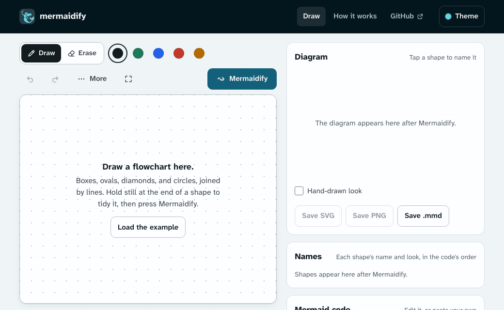

# mermaidify



[Website](https://ryanjosephkamp.github.io/mermaidify/) · [Docs](https://ryanjosephkamp.github.io/mermaidify/docs/) · [Report a bug or suggest a feature](https://github.com/ryanjosephkamp/mermaidify/issues)

**Sketch a flowchart, get Mermaid.** Draw boxes, ovals, diamonds, circles, triangles, and other shapes with a finger, a pen, or a mouse, press **Mermaidify**, and get the closest [Mermaid](https://mermaid.js.org/) flowchart or state diagram. Name the shapes and lines, edit the code, copy it, and save the diagram as SVG, PNG, or `.mmd`.

The drawing is read on your device in a few milliseconds, with no account, no server, and no AI model. Your drawings stay in your browser.

**Open it:** [ryanjosephkamp.github.io/mermaidify](https://ryanjosephkamp.github.io/mermaidify/). It is made for a phone's screen and a pen as much as for a mouse: once a pen is seen, only the pen draws, so a resting palm draws nothing.

## What it reads

| You draw | Mermaid writes |
| --- | --- |
| A box | `A["Node 1"]` |
| A box in a box | `A[["Node 1"]]` |
| A wide oval | `A(["Node 1"])` |
| A circle | `A(("Node 1"))` |
| A circle in a circle | `A((("Node 1")))` |
| A diamond | `A{"Node 1"}` |
| A hexagon | `A{{"Node 1"}}` |
| A trapezoid, wide at the bottom | `A[/"Node 1"\]` |
| A trapezoid, wide at the top | `A[\"Node 1"/]` |
| A parallelogram, leaning right or left | `A[/"Node 1"/]`, `A[\"Node 1"\]` |
| A triangle, pointing up or down | `A@{ shape: tri, label: "Node 1" }`, `shape: flip-tri` |
| A small shape filled in, or a small circle around a filled dot | `A@{ shape: sm-circ, … }`, `shape: fr-circ` |
| A shape around other shapes | `subgraph G1 ["Group 1"]` |
| A line, with a hooked, "V", closed, or filled-in head, or none | `A --> B`, or `A <--> B` with heads at both ends |
| A line drawn as dashes | `A -.-> B` |
| A line gone over again | `A ==> B` |
| A line you named | `A -->\|"yes"\| B` |
| Green, blue, red, or amber ink | `classDef`, `style`, and `linkStyle` |

A shape is only a look: every shape starts as a plain node, and you can change any shape's look or any line's style after reading it. Draw in any order, because the reading depends on the finished drawing, not on which stroke came first. Lines may curve, and a short line may have a head as big as itself.

A line with no head points the way it was drawn, and arrows that come back around make a loop. A line that stops short of the shape it points at still reaches it, and each drawing is read at the size it had on screen, so drawing zoomed out reads the same as drawing at 100%.

The docs explain [the five steps of the reading](https://ryanjosephkamp.github.io/mermaidify/docs/reader/) and [how to draw for a clean one](https://ryanjosephkamp.github.io/mermaidify/docs/drawing-tips/).

A flowchart shows the steps of a process in order. A **state diagram** shows the conditions one thing can be in, such as an order that is placed, paid, and shipped, and what moves it from one to the next. Read as a state diagram, the same drawing writes `stateDiagram-v2`:

| You draw | Mermaid writes |
| --- | --- |
| A small filled dot, or a small circle, with an arrow out | `[*] --> A` |
| A circle with a dot or a circle in it, with an arrow in | `A --> [*]` |
| A box, an oval, or any other shape | `state "State 1" as A` |
| A diamond | `state B <<choice>>` |
| A shape around other shapes | `state "Group 1" as G1 { … }` |
| An arrow you named | `A --> B : paid` |

## What is in it

- **The drawing surface:** five inks, an eraser with two kinds (whole strokes, or only the ink it passes over), undo, redo, and a one-press **Clear**. Pinch or use the wheel to zoom from 10% to 400%, use the hand and <kbd>Space</kbd> to move around, go full screen, and rely on palm rejection for a pen. The pen's side button erases while held.
- **Select:** press a stroke and drag to move it, or drag a box (or draw a lasso) around strokes. <kbd>Shift</kbd> or <kbd>⌘</kbd> and a click adds one. Then move, turn, grow, cut, copy, paste, duplicate, group, snap, or delete them. **Snap** makes chosen shapes and arrows clean, and joins a line and a head drawn apart into one arrow. Names go with the strokes they belong to.
- **Add:** clean shapes for the ones that are hard to draw, arrows one way and both ways, and 18 templates to start from: flowcharts, state diagrams, and agent workflows from [grooph](https://ryanjosephkamp.github.io/grooph/)'s patterns, already named.
- **Hold to snap:** hold still at the end of a shape, and it becomes the clean shape it is closest to. Hold at the end of a line, and it becomes straight. Hold at the end of an arrow, and it becomes a clean arrow that you aim by moving before you lift. The press draws on after a snap, so a box in a box takes one stroke.
- **The reading:** the line under the drawing says what was found, dashed outlines show each shape with its letter, each line read as an arrow glows, and marks that were left out are shaded. A tap on an empty place, or <kbd>Esc</kbd>, puts it away.
- **Names, looks, and line styles:** tap a shape or a line on the drawing, or a shape or a line's name in the diagram, and type its name, or write it with a pen where the phone's keyboard turns handwriting into text. Pick another look for a shape, or plain, dotted, or thick for a line, from its menu without drawing it again. All of them follow their shapes and lines when you draw more, and the names stay on the drawing, which a switch in **More** hides.
- **Flowchart or state diagram:** **Read as**, under the diagram or in **More**, reads the same drawing either way, and the choice is saved with it. In a state diagram, each shape's menu makes it a state, a choice, or a start or end.
- **The code:** edit it, or paste your own Mermaid, and the diagram follows. **Rebuild from the drawing** goes back.
- **Saving and sharing:** SVG with plain text names that other editors open as they look here, PNG at twice the size with the fonts inside, and `.mmd`. **Copy embed code** gives a frame for any web page, with the diagram's code in its address. **Save the drawing** keeps the strokes, names, and code as JSON to open again later.
- **Offline:** once opened, the site works with no connection, and it installs as an app from Chrome, Edge, or Safari.
- **Six themes,** each in light and dark, from the theme menu.

If a drawing reads wrong, that is the most useful thing to send. Use **More**, then **Save the drawing**, and attach the file to an [issue](https://github.com/ryanjosephkamp/mermaidify/issues).

## The reader on its own

The reader is one module with no dependencies, in [`src/reader/`](src/reader/index.ts): strokes in, a flowchart or a state diagram and its Mermaid text out. It runs the same in a browser, a worker, or Node.

```ts
import { recognize, toMermaid, toStateMermaid } from "./src/reader/index.ts";

// A stroke is { pts: [[x, y], …], zoom? }: its points, in CSS pixels or any unit near them, and the zoom it was drawn at, if not 100%.
const reading = recognize(strokes);
reading.nodes; // [{ id: "A", kind: "rect", label: "Node 1", bb, strokes: [0], parent: null, ... }]
reading.edges; // [{ id: "L1", from: "A", to: "B", both: false, assumed: false, style: "plain", ... }]
console.log(toMermaid(reading, { labels: { A: "Write the draft", L1: "next" } }));

// The same strokes as a state diagram: each node also has a role, "state", "choice", or "dot" (a start or an end).
console.log(toStateMermaid(recognize(strokes, { diagram: "state" })));
```

A shape's `kind` (`rect`, `diamond`, `circle`, and so on) is only how it looks, so an app that gives shapes meanings maps kinds to its own. `snap(points)` turns the end of a stroke into a clean shape or a straight line, as holding still does on the page.

## How well it reads

Each build scores the reader two ways, and the tests hold both to a floor. [How well it reads](https://ryanjosephkamp.github.io/mermaidify/docs/accuracy/) explains why these two, how they are scored, and what they cannot tell you.

- **On 300 drawings people made,** from Google's [Didi dataset](https://github.com/google-research/google-research/tree/master/didi_dataset): flowcharts drawn over charts that Graphviz laid out, so each chart says what is there. The reader was tuned on other drawings from the set, never on these. On the current reader, 95.0% of shapes are found (1,139 of 1,199), 89.1% of boxes, ovals, diamonds, and parallelograms are read with their look (830 of 932), 82.2% of arrows are read right (906 of 1,102), all 906 of them as plain lines, as drawn, and 67.0% of whole drawings (201 of 300).
- **On 1,000 generated wobbly flowcharts** with known answers, about half their lines drawn as dashes or gone over twice: 99.6% of shapes (3,958 of 3,972) and 99.4% of arrows (3,536 of 3,556) are read right, 99.0% of dotted and thick lines with their style (1,809 of 1,827), and 97.3% of whole drawings, at a median of a few milliseconds per drawing. With every line drawn plain, 99.8% of arrows and 98.5% of whole drawings read right. Generated drawings are tidier than a person's, so this is a floor for the reader's logic.
- **On 1,000 generated state diagrams,** read as state diagrams: 99.9% of starts and ends are found (2,128 of 2,130), every state, choice, and composite state, 99.9% of transitions are read right (4,989 of 4,993), and 99.6% of whole diagrams (996 of 1,000). No public set of hand-drawn state diagrams is known, so these are generated only.

## Run it

You need Node 22.18 or later.

```bash
git clone https://github.com/ryanjosephkamp/mermaidify.git && cd mermaidify
npm install
npm run dev
```

Then open [localhost:4371](http://localhost:4371/). `npm run build` writes the site to `dist/`, which any static host can serve from any path.

## Tests

```bash
npx playwright install chromium  # once, before the browser tests
npm test                     # the reader's unit tests
npm run bench -- --floor     # the generated benchmark, held to its floor
npm run measure -- --floor   # the 300 drawings people made, held to their floor
npm run build && npm run e2e # every page in Chromium, at a phone's size and a computer's
npm run check                # all of it, with the type check
```

The browser tests draw with pen, touch, and mouse events, and check palm rejection, erasing, undo, naming shapes and lines, line styles, the saves, a saved drawing opened again, and the theme menu. `node scripts/brand.ts` redraws the icons and the link preview from `public/favicon.svg`, and `node scripts/demo-gif.ts` records the GIF above.

## Layout

| Folder | What it holds |
| --- | --- |
| `src/reader/` | The reader: geometry, shapes, arrowheads, the five steps, and the Mermaid writer |
| `src/app/` | The Draw page: the drawing surface, Mermaid, the saves, the embed page's script, and drawing files |
| `src/site/` | The header, the footer, and the theme menu of every page, and the docs' list of pages |
| `src/docs/` | The script every docs page runs |
| `src/offline/` | The service worker that keeps the site working with no connection |
| `src/styles/` | The look: tokens, the header and footer, and each page |
| `docs/` | The docs: the index and a folder for each page, and the GIF above |
| `embed/` | The page that the embed code's frame shows |
| `how-it-works/` | The old How it works address, which sends readers on to the docs |
| `404.html` | The page shown for an unknown address |
| `public/` | Fonts, icons, the web app manifest, and the link preview image |
| `test/`, `e2e/` | The reader's tests and its benchmark; the drawings people made (`test/didi/`); the browser tests |
| `scripts/` | The benchmark, the score on drawings people made and the script that takes them from the dataset, the figures the docs print, the icons, and the demo GIF |
| `.github/workflows/` | The checks that run on pull requests, and the deploy to GitHub Pages |

## License and author

MIT, © 2026 Ryan Kamp. [Mermaid](https://mermaid.js.org/) draws the diagrams (MIT). The text is set in Atkinson Hyperlegible Next and Mono by the Braille Institute (SIL Open Font License; the license files are in `public/assets/fonts/`). The footer's brand icons are from [Simple Icons](https://simpleicons.org/) (CC0). The drawings in `test/didi/` are from the Didi dataset by Google LLC (CC BY 4.0); see [its notes](test/didi/README.md).

Made by [Ryan Kamp](https://ryanjosephkamp.github.io/). If mermaidify is useful to you, you can [sponsor my work on GitHub](https://github.com/sponsors/ryanjosephkamp).
